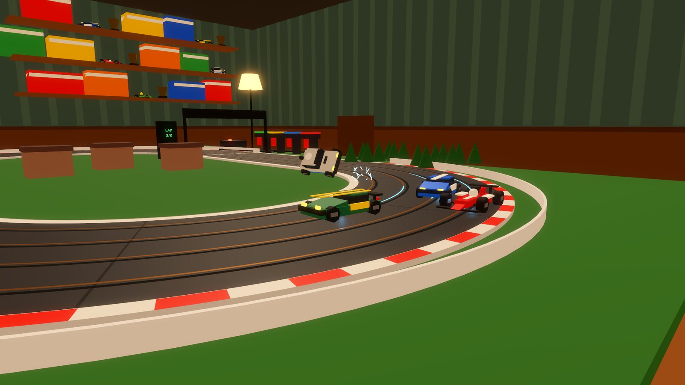
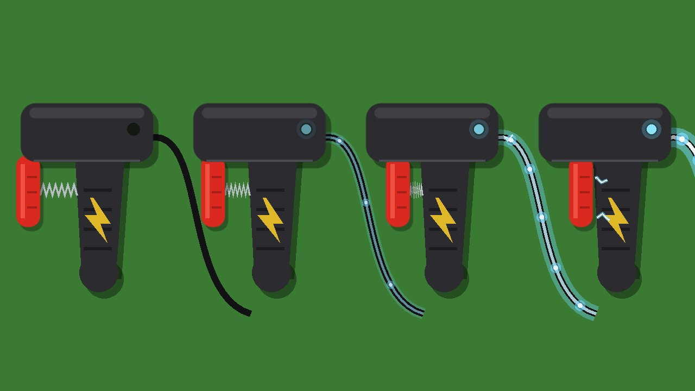
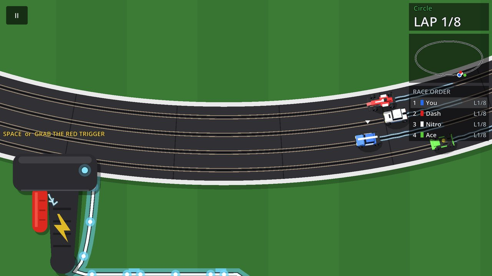
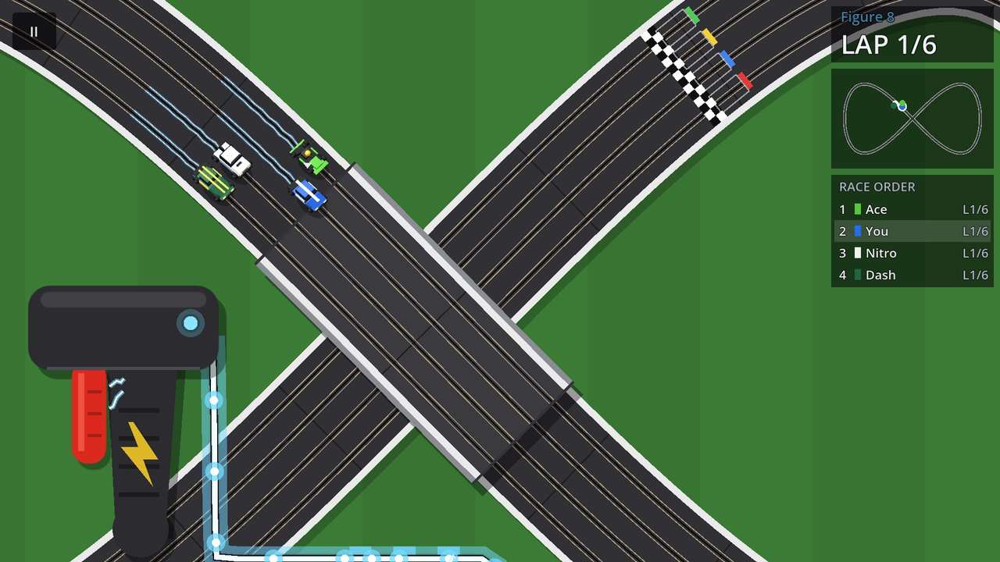
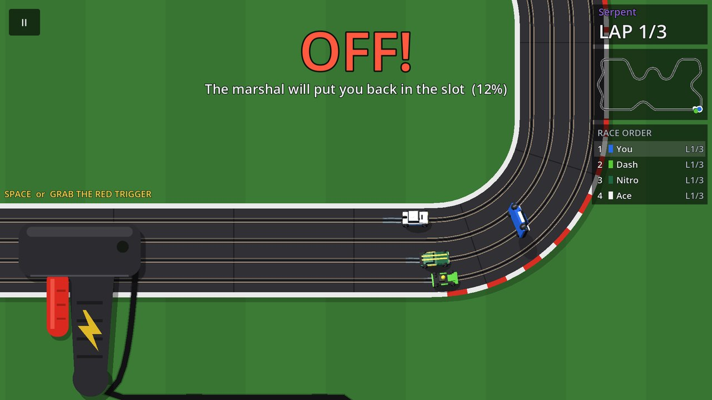
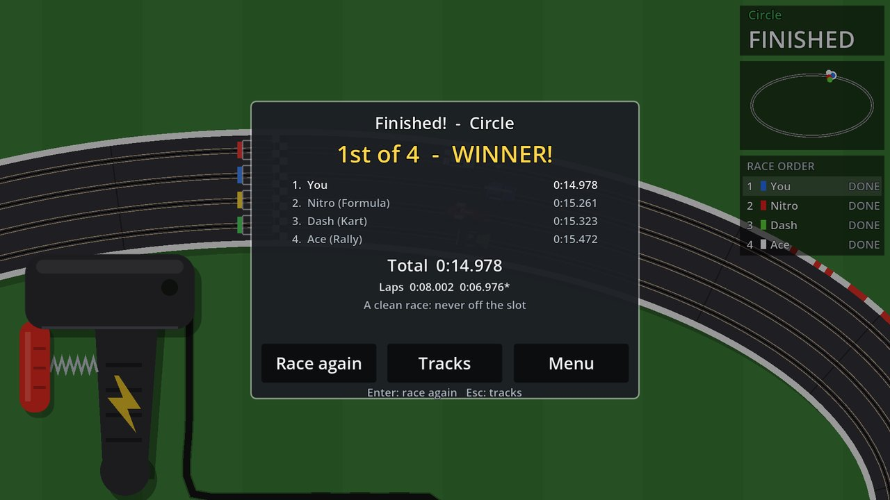
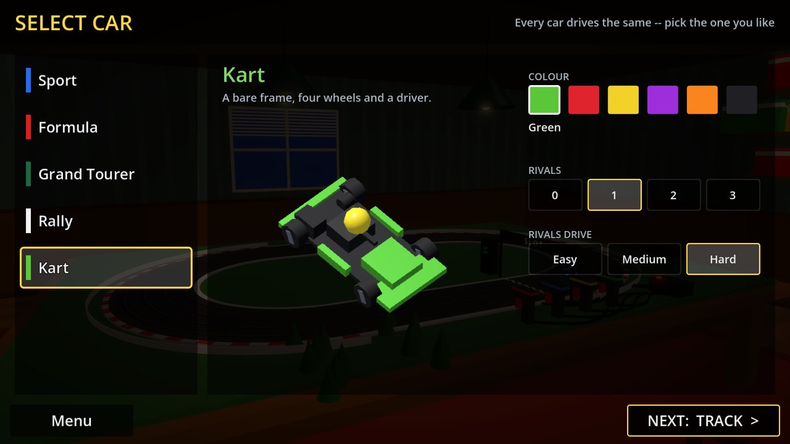
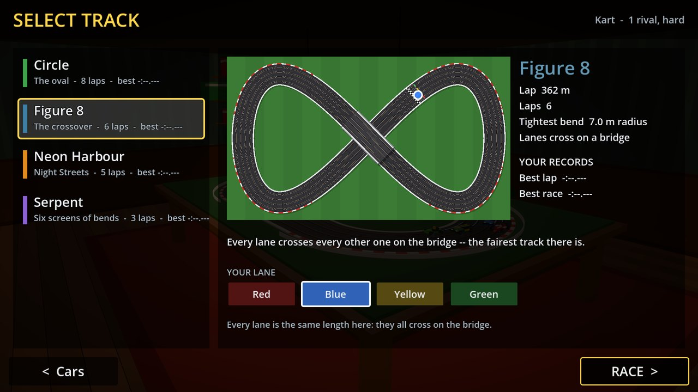
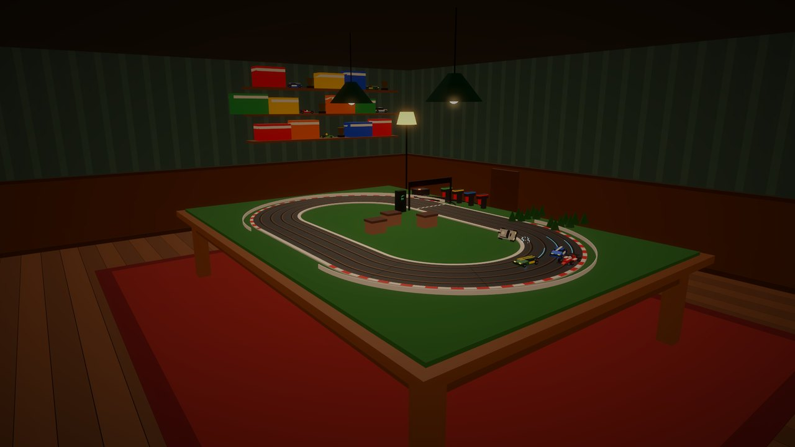

  

<h3 align="center">One trigger. Four lanes. Don't come off.</h3>

  
  &nbsp;
  

---

Remember the slot-car set on the big table, the hum of the motors, the smell of hot braids, and the
car that always flew off on the same bend? **SLOT** is that, on your screen.

You never steer. Your car's guide blade is in the slot, and the track takes it wherever the track
goes. All you have is the **trigger**. Squeeze it and the car goes. Squeeze harder and it goes faster.
Every bend has a speed it can be taken at, and the only one who decides whether you make it is you.

## How it plays

  

* **Grab the red trigger** and drag it: right for more power, left for less. Let go and the motor
  brakes. The cable lights up as the current flows, brighter the harder you squeeze. (Or just hold
  **Space**.)
* **Watch the tail.** Near a bend's limit the car's tail swings out. That's your only warning.
  There are no meters.
* **Don't come off.** Too fast and the car slides, its pickups crackling with sparks, and flies off the track. The marshal puts
  it back where it left, and those two seconds never come back.

## Screenshots

<table>
  <tr>
    <td></td>
    <td></td>
  </tr>
  <tr>
    <td align="center"><b>Four lanes, four cars</b>, side by side through the bends</td>
    <td align="center"><b>Figure 8:</b> every lane crosses over the bridge</td>
  </tr>
  <tr>
    <td></td>
    <td></td>
  </tr>
  <tr>
    <td align="center"><b>OFF!</b> One bend too greedy</td>
    <td align="center"><b>Winner.</b> Every lap timed, every record kept</td>
  </tr>
  <tr>
    <td></td>
    <td></td>
  </tr>
  <tr>
    <td align="center"><b>Pick your car</b> and its colour</td>
    <td align="center"><b>Pick your track</b> and your lane</td>
  </tr>
</table>

## What's in the box

* 🏁 **Four circuits:** the **Circle** to learn on, the **Figure 8** with its bridge, the tight
  **Neon Harbour**, and the long, winding **Serpent**.
* 🚗 **Five cars:** Sport, Formula, Grand Tourer, Rally and Kart, in six colours each. They all drive
  exactly the same, so the race is between drivers, not wallets.
* 🛣️ **Four lanes,** and the lane is a choice: the inside is shorter but its bends are tighter.
* 🤖 **Up to three rivals,** on Easy, Medium or Hard. They use the same single trigger you do, and
  they come off too when they get greedy.
* ⚡ **Electricity everywhere:** sparks off the braids, current running down the lanes, a motor that
  whines higher as it speeds up.
* ⏱️ **Records** for your best lap and best race on every track.

  

## Controls

| | |
| --- | --- |
| **Grab the red trigger** and drag right / left | more / less power. Let go to brake |
| **Space** (or Up / W) | power: it builds the longer you hold |
| **Move the mouse** | moves the controller out of your car's way |
| **Gamepad** | right trigger for power |
| **Esc** | pause |
| **Z** or mouse wheel | see the whole circuit, or ride with your car |
| **R** | restart the race |

## Play

* **In your browser:** [zzzteph.github.io/slot](https://zzzteph.github.io/slot/). Nothing to install.
* **On Windows:** download the latest `SLOT-v…-windows.zip` from
  [Releases](https://github.com/zzzteph/slot/releases/latest), unzip it and run `SLOT.exe`.

---

Made with <a href="https://godotengine.org">Godot</a> · MIT licence · a slot-racing fork of <i>Rope Racers</i>

